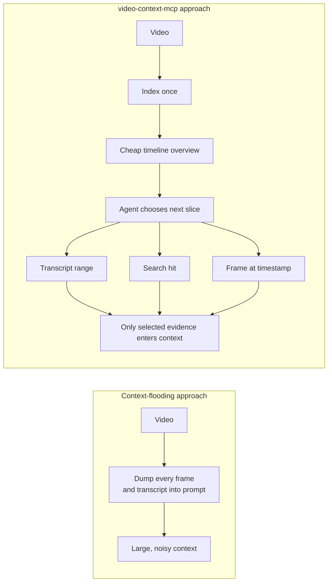
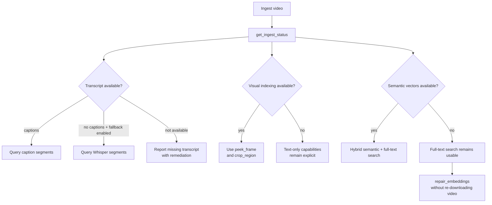
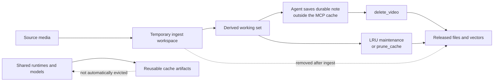

# Architecture

## Design premise

Video tooling for agents fails in two ways: provider lock-in (vision pipeline hardwired to one LLM API) and eager context dumping (N keyframes shoved into the prompt). This server does neither:

1. **Model-agnostic by construction.** The server extracts *data* (transcript, chapters, frames, OCR). Interpretation belongs to the client model. In Phase 2, `peek_frame` returns an image content block that the connected model — Claude, GPT, Gemini, a local VLM — looks at itself. No vision model lives in the server.
2. **Lazy scrubbing.** `get_video_timeline` is a cheap text overview; everything heavier is pull-based (`get_transcript` ranges, `search_videos` hits, per-timestamp frames). The agent decides what enters context.

The context boundary is explicit:



Source: [`lazy-context-boundary.mmd`](docs/assets/lazy-context-boundary.mmd).

## Ingestion job model

MCP tools are request/response, but ingesting a video takes seconds-to-minutes. `ingest_video` registers a job and returns immediately; an in-process queue (max 2 concurrent, per-video dedup) runs the stage machine:

```mermaid
flowchart LR
    P[pending] --> U[setup]
    U --> M[metadata]
    M --> T[transcript]
    T --> V{visual enabled?}
    V -->|yes| R[frames]
    V -->|no| E{embeddings enabled?}
    R --> O[ocr]
    O --> E
    E -->|yes| B[embed]
    E -->|no| D[done]
    B --> D
    T -. no captions + whisper fallback .-> W[whisper]
    W --> E
    B -. semantic failure .-> D
    P -. unrecoverable failure .-> X[error]
    M -. unrecoverable failure .-> X
    T -. unrecoverable failure .-> X

    D[done<br/>with capabilities and warnings]
Each stage commits rows as it finishes, so partial results are queryable mid-ingest. Tools that need a missing stage return an actionable "still ingesting / stalled" message instead of blocking. On startup, rows stuck mid-stage from a killed process are marked `INGEST_INTERRUPTED`.

Source: [`ingestion-state-machine.mmd`](docs/assets/ingestion-state-machine.mmd).

## Storage

`~/.cache/video-context-mcp/` holds a single `index.sqlite` (WAL, FK cascade) plus one directory per video (`<id>/frames/` for keyframes, `<id>/exports/` for reproducible transcript files, and `tmp/` during ingest, deleted after). Source media is never retained — only derived artifacts. Transcript exports are disposable copies generated from canonical segment rows and follow the same whole-video cleanup lifecycle.

Tables: `videos` (identity, title/channel/upload date, stage, and error), `jobs` (progress), `segments` (+ `segments_fts` FTS5 external-content, porter), `chapters`, and Phase-2-ready `frames` / `ocr_blocks`. Content addressing: YouTube ID as-is; local files → `local-<sha256(size+head8MB)[:12]>`.

Phase 4 adds dense embeddings in LanceDB beside the sqlite file (same pattern as `semantic-code-mcp`), fused with FTS via RRF.

Speech and screen evidence converge on search and visual inspection:

```mermaid
flowchart TB
    V[Video source<br/>YouTube ID, URL, or local file] --> P[Ingestion pipeline]
    P --> M[Metadata and chapters]
    P --> S[Transcript segments]
    P --> K[Keyframes]
    K --> O[OCR blocks]
    S --> F[Full-text index]
    O --> F
    S --> E[Dense embeddings]
    O --> E
    F --> R[Reciprocal-rank fusion]
    E --> R
    R --> H[search_videos hits]
    K --> G[peek_frame image content]
    O --> G
    G --> L[Connected model interprets<br/>the visual evidence]
```

Source: [`multimodal-index.mmd`](docs/assets/multimodal-index.mmd).

Default embedding initialization is single-flight within a process and protected
by a cross-process lease. The pinned ONNX artifact is checksum-validated; only
the exact invalid model file is removed and retried once. Semantic failures
remain warnings, and search continues with SQLite FTS.

`repair_embeddings` enters only the existing `embed` job stage and rebuilds
vectors from committed segment/OCR rows. It shares ingestion concurrency and
leases but never resolves yt-dlp/FFmpeg or touches source-derived rows.

When optional capabilities are unavailable, the contract stays explicit and
usable:



Source: [`capability-fallbacks.mmd`](docs/assets/capability-fallbacks.mmd).

The cache lifecycle is similarly explicit:



Source: [`cache-lifecycle.mmd`](docs/assets/cache-lifecycle.mmd).

## Error taxonomy

`yt-dlp` failure modes (bot check, private/members-only/age-restricted, geo-block, removed video, network) are pattern-matched in `errors.ts` into typed codes with agent-actionable remediation (e.g. `NEEDS_COOKIES` → "set `YTDLP_COOKIES_FILE`"). Unknown failures surface a bounded stderr tail, never a dump.

## Capability roadmap

The shipped foundation covers transcript and visual extraction, local ASR,
hybrid search, selective semantic repair, managed runtimes, and bounded cache
lifecycle. Near-term work focuses on caption-language selection, resilient
visual extraction, and broader long-form evaluation. Code-diff reconstruction,
diagram-to-Mermaid, and deictic alignment remain experimental client-vision
workflows rather than server-side model dependencies.
