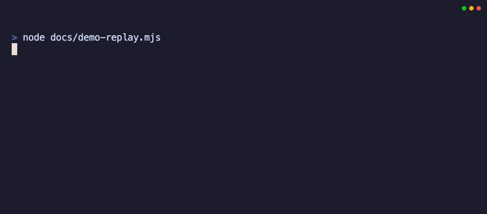

# video-context-mcp

[](https://github.com/smallthinkingmachines/video-context-mcp/actions/workflows/ci.yml)
[](https://github.com/smallthinkingmachines/video-context-mcp/actions/workflows/runtime-smoke.yml)
[](LICENSE)

Model-agnostic MCP server that turns videos into an **interactive, queryable knowledge structure** — transcript, chapters, keyframes, OCR, and search — that any MCP client model (Claude, GPT, Gemini, local models) can **scrub lazily** instead of receiving a context-flooding dump of keyframes.

Most video tools for agents either lock you to one model provider or eagerly dump dozens of frames into context. `video-context-mcp` treats a video like a filesystem: ingest once, then let the agent pull exactly the slice it needs — a timeline overview, a transcript range, a search hit, or a single frame at a timestamp.



## Requirements

- Node ≥ 22
- Network access on first use

| Platform | Architecture | Support |
|---|---|---|
| macOS | Apple Silicon and Intel | Managed runtime tested |
| Windows | x64 | Managed runtime tested |
| Linux | glibc x64 | Managed runtime tested |
| Linux | musl or ARM | Use system toolchain mode; managed binaries are not supplied |

No Python, Nix environment, system package manager, or preinstalled media tools
are required on the managed-runtime platforms. The server securely downloads
pinned yt-dlp and FFmpeg builds only when a feature needs them, then caches them
under `VCM_CACHE_DIR`. OCR and caption-less speech use local Tesseract.js and
Transformers.js fallbacks when native tools are unavailable. The first
operation can therefore take longer and requires enough disk space for the
requested runtime and models.

## Install & register

Not yet published to npm — install from source:

```bash
git clone https://github.com/smallthinkingmachines/video-context-mcp.git
cd video-context-mcp
npm install && npm run build
```

**Claude Code / Gemini-style JSON config:**

```json
{
  "mcpServers": {
    "video-context": {
      "command": "node",
      "args": ["/path/to/video-context-mcp/dist/index.js"]
    }
  }
}
```

**Codex (`~/.codex/config.toml`):**

```toml
[mcp_servers.video-context]
command = "node"
args = ["/path/to/video-context-mcp/dist/index.js"]
```

Once published to npm, `npm install -g @smallthinkingmachines/video-context-mcp` will provide a `video-context-mcp` binary you can use as the `command` directly.

Optional bootstrap and diagnostics:

```bash
video-context-mcp setup          # prefetch yt-dlp + FFmpeg
video-context-mcp setup --all    # also prefetch OCR, ASR, and embedding models
video-context-mcp setup --update # explicitly activate this release's pinned tools
video-context-mcp doctor         # read-only health and remediation report
```

`doctor --json` also reports the embedding model cache as `not_cached`,
`verified`, `invalid`, or `custom_unverified`. The default pinned MiniLM ONNX
artifact is size- and SHA-256-checked; an invalid copy is replaced once on the
next embedding load while full-text search remains available.

## Tools

| Tool | Purpose |
|---|---|
| `ingest_video` | Index a YouTube URL/ID or local file (async job, returns immediately) |
| `get_ingest_status` | Stage, progress, what's queryable, actionable errors |
| `get_video_timeline` | Compact overview: structured metadata + Markdown chapters/outline |
| `get_transcript` | Timestamped transcript, sliceable inline or exportable as a complete local file |
| `search_videos` | Hybrid search (full-text + semantic, RRF-fused) over speech AND on-screen text |
| `repair_embeddings` | Rebuild semantic vectors from stored text without downloading the video again |
| `peek_frame` | The keyframe image nearest a timestamp + its OCR text — *you* look at it |
| `crop_region` | Zoom into a bbox of a frame (IDE panel, diagram) for dense text |
| `list_videos` / `delete_video` | Cache inventory and explicit release after saving a note |
| `prune_cache` | Preview or apply quota-based whole-video LRU cleanup |

Typical agent flow: `ingest_video` → poll `get_ingest_status` → inspect timeline/search/transcript/frame slices → save the resulting note elsewhere → `delete_video` to release the working assets. If semantic indexing alone failed, call `repair_embeddings` instead of forcing a full re-ingest.

Inline transcript output stays compact and includes a structured resume
timestamp when truncated. A local stdio client that can read the server's
filesystem can request the entire selected range without another MCP round
trip:

```text
get_transcript(video_id="…", delivery="file")
```

The response contains an absolute UTF-8 file path. That export is regenerated
from SQLite, counted against the video cache, and removed with `delete_video`
or automatic cache eviction.

## Configuration

All settings are optional; see `.env.example`. Managed tools are the default.
Set `VCM_TOOLCHAIN_MODE=system` to restore PATH-only resolution. An explicit
`VCM_YTDLP_BIN`, `VCM_FFMPEG_BIN`, or `VCM_FFPROBE_BIN` always wins. OCR and
ASR providers can be selected with `VCM_OCR_BACKEND` and `VCM_ASR_BACKEND`.
Cookies for restricted YouTube videos remain user-supplied through
`YTDLP_COOKIES_FILE` and are never bundled.

## Troubleshooting

Start with `video-context-mcp doctor --json`; it reports platform support,
managed tools, cache permissions, configured backends, and embedding-model
integrity without changing the installation.

- **First call is slow:** yt-dlp, FFmpeg, OCR/ASR, and embedding artifacts are
  downloaded lazily. Run `video-context-mcp setup --all` to prefetch and
  load-test everything.
- **YouTube requests sign-in or rejects automation:** export a fresh
  Netscape-format cookies file and set `YTDLP_COOKIES_FILE`. Never paste or
  commit the file.
- **`EMBED_FAILED`:** full-text search still works. The default ONNX file is
  checksum-validated and self-heals once; run `setup --all`, then call
  `repair_embeddings(video_id)` to rebuild only semantic vectors.
- **Cache permission or disk errors:** point `VCM_CACHE_DIR` at an absolute,
  writable path with adequate free space, then rerun `doctor`.
- **Dense screen text is hard to read:** YouTube may restrict yt-dlp to a 360p
  progressive stream. The condition appears in `get_ingest_status`; updating
  yt-dlp or re-ingesting later may restore 720p.
- **Linux musl/ARM:** set `VCM_TOOLCHAIN_MODE=system` and provide compatible
  yt-dlp/FFmpeg binaries through PATH or the explicit `VCM_*_BIN` variables.

## Cache lifecycle

Downloaded source video/audio, captions, staging files, WAVs, and temporary
crops are removed automatically after every ingest. Retained transcript, OCR,
keyframes, and vectors form a queryable working set until the agent calls
`delete_video` after saving its note.

`VCM_MAX_CACHE_GB` defaults to 20 GB and applies only to retained per-video
data. If agents forget to release videos, startup and ingestion maintenance
evicts complete videos by least-recently-used order until usage is below 90%
of the budget. Running and just-completed ingests are protected; an oversized
new result is retained with a warning. Shared managed binaries and OCR/ASR/
embedding models are reusable and never automatically evicted. Use
`list_videos` for accounting or `prune_cache` for a dry-run preview.
Interrupted runtime and native ASR downloads are reclaimed on the next server
startup or `setup` run after they have remained inactive for at least one hour.

## Roadmap

**Shipped:** metadata and captions, structured timeline output, ranged/file
transcripts, local ASR, lazy keyframes and crops, native/WASM OCR, hybrid
dense+lexical search, selective embedding repair, checksummed managed runtimes,
diagnostics, and quota-based whole-video cache cleanup.

**Next:** improve caption-language selection, make visual extraction more
resilient to YouTube streaming changes, and expand repeatable evaluation across
long-form video types.

**Experimental:** on-screen code-diff reconstruction, diagram-to-Mermaid, and
deictic alignment between speech and visible regions.

## Notes

Intended for personal research and note-taking on content you can legitimately access. Caption/metadata fetching uses `yt-dlp`; respect YouTube's Terms of Service and copyright. Cookies are user-supplied and never bundled.

Managed executables retain their upstream licenses; see
[`THIRD_PARTY_NOTICES.md`](THIRD_PARTY_NOTICES.md). The npm package stays small:
runtime binaries and models are downloaded into the disposable cache, not
embedded in the tarball.

**Trust boundary:** the server trusts its MCP client. In particular, `ingest_video` will read any local file path the client asks for (by design — it's your agent indexing your files), and the cache is plain files on disk. Run it as a local stdio server for clients you control; do not expose it to untrusted clients or over the network without adding your own authorization layer.

## Development

```bash
just setup   # npm install
just ci      # lint + typecheck + test + build
just e2e     # network-gated end-to-end test against a real video
```

Nix is optional; the repository's standard workflow is Node 22 plus `just`.
Use `npm run demo` for the network-gated terminal walkthrough. See
[`CONTRIBUTING.md`](CONTRIBUTING.md) for project rules,
[`SECURITY.md`](SECURITY.md) for private reporting, and
[`CHANGELOG.md`](CHANGELOG.md) for release notes.

MIT © Studio1804, Small Thinking Machines, and Ricardo Ledan
