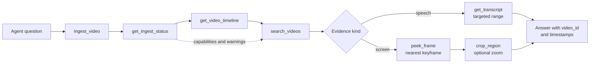
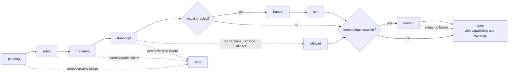
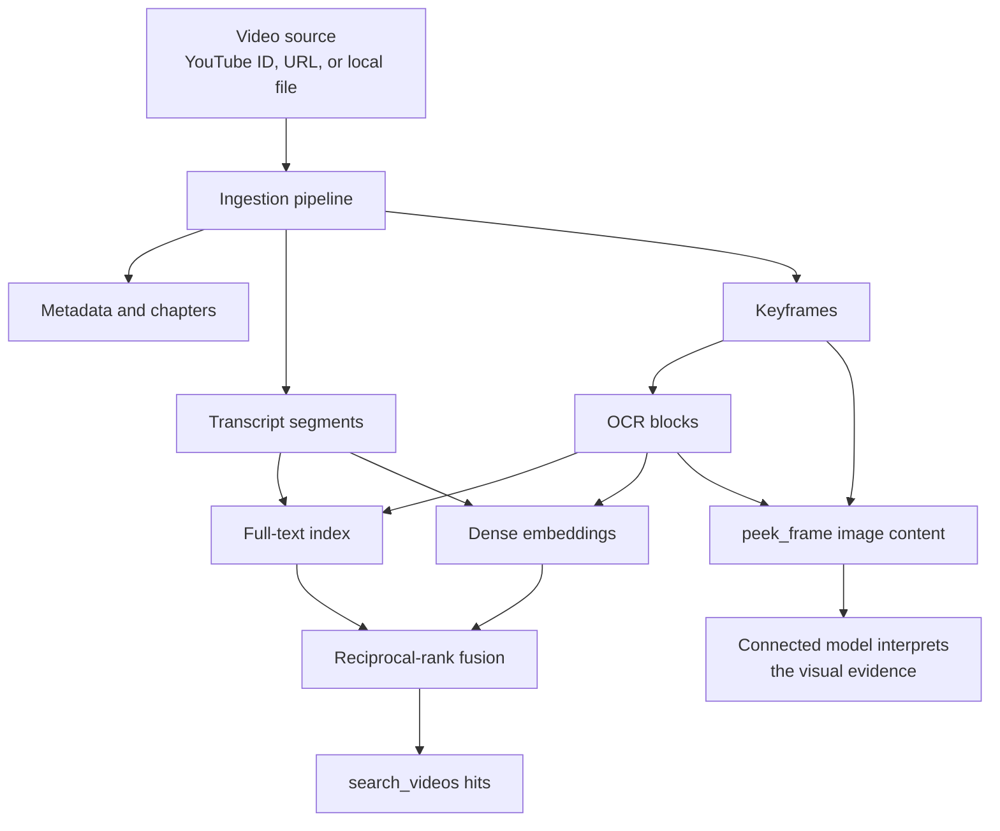
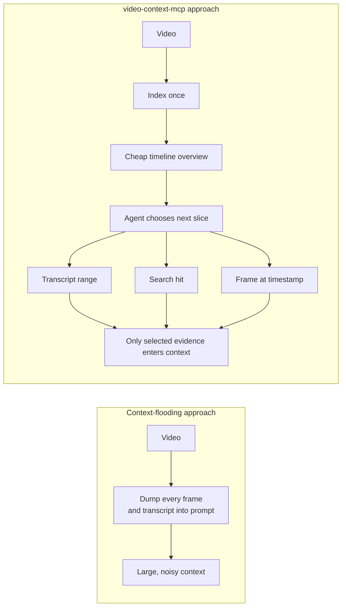
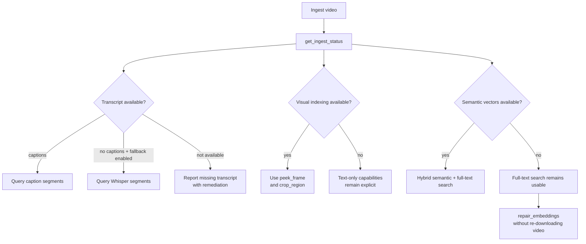
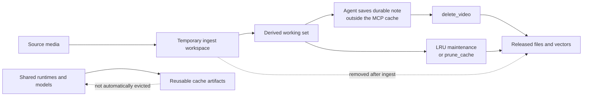
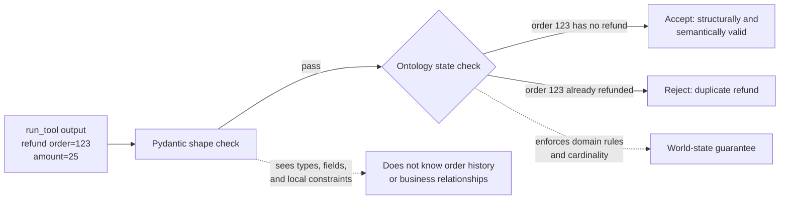

# Project diagrams

These diagrams explain the shipped architecture and operating model of
`video-context-mcp`. The editable Mermaid sources live beside them in
[`assets/`](assets/); the article can reference this page or reuse the source
diagrams directly.

## Agent evidence loop

Use this to explain how an agent moves from a question to focused,
timestamped evidence.

Source: [`agent-evidence-loop.mmd`](assets/agent-evidence-loop.mmd)

## Incremental ingestion

Use this to explain why partially completed ingestion remains useful and how
optional visual, Whisper, and embedding stages behave.

Source: [`ingestion-state-machine.mmd`](assets/ingestion-state-machine.mmd)

## Multimodal index

Use this to show how speech and on-screen evidence become searchable without
putting a vision model inside the server.

Source: [`multimodal-index.mmd`](assets/multimodal-index.mmd)

## Lazy context boundary

Use this to explain the project’s central design choice: index once, then
pull only the evidence the agent needs.

Source: [`lazy-context-boundary.mmd`](assets/lazy-context-boundary.mmd)

## Capability fallbacks

Use this to explain how status reports what is available instead of treating
every missing optional capability as a total failure.

Source: [`capability-fallbacks.mmd`](assets/capability-fallbacks.mmd)

## Cache lifecycle

Use this to explain what is disposable, what is retained, and where durable
notes belong.

Source: [`cache-lifecycle.mmd`](assets/cache-lifecycle.mmd)

## Pydantic versus ontology validation

Use this example when explaining the difference between local output shape and
domain consistency.

Source: [`pydantic-vs-ontology.mmd`](assets/pydantic-vs-ontology.mmd)

The animated [`demo.gif`](assets/demo.gif) provides a concrete terminal
walkthrough of the final example.
